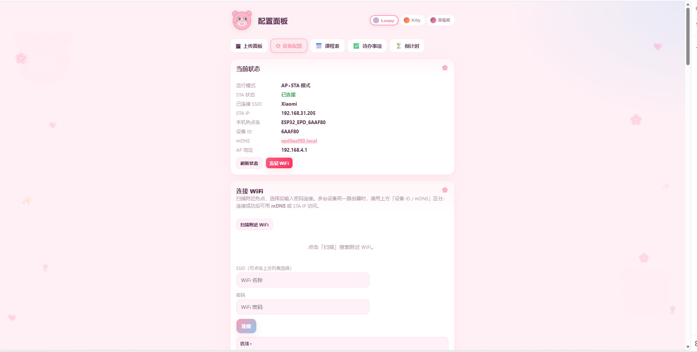
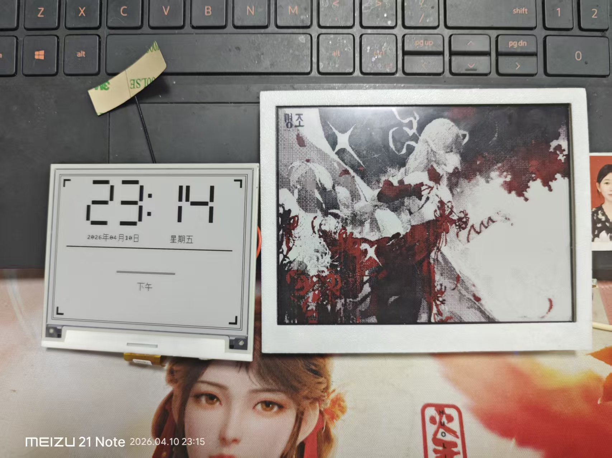
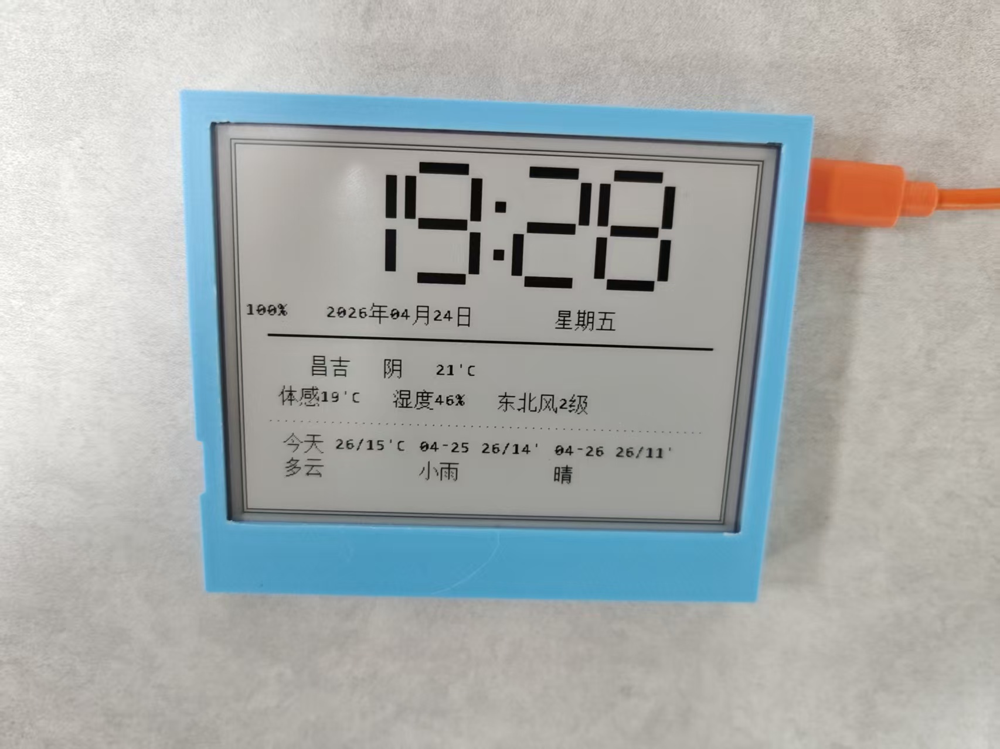
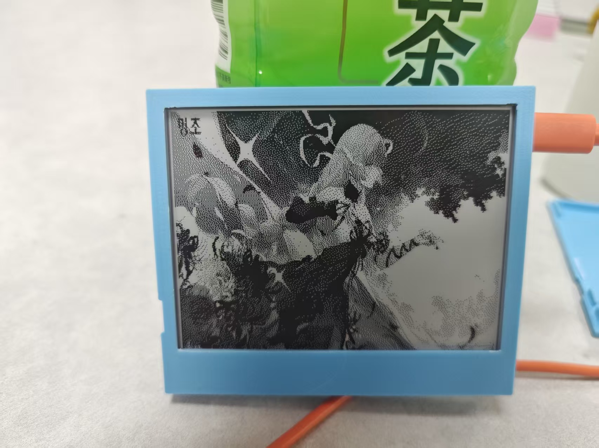
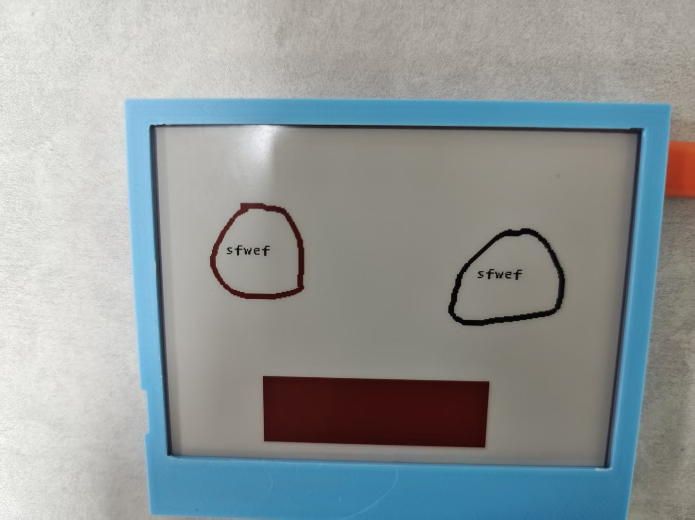
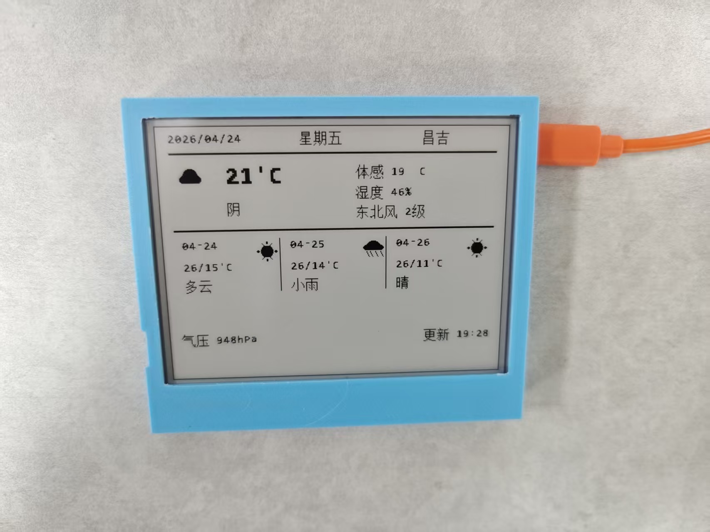
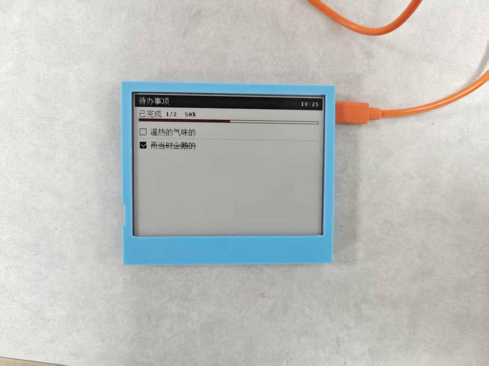
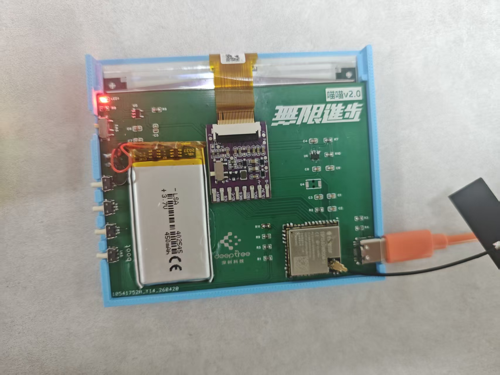
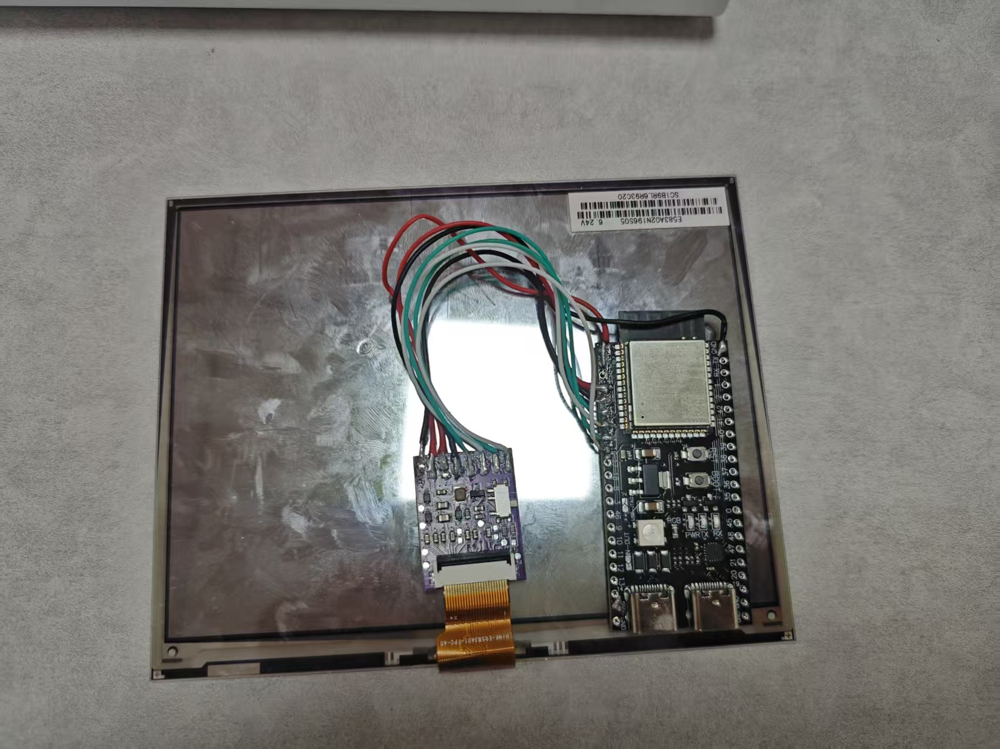
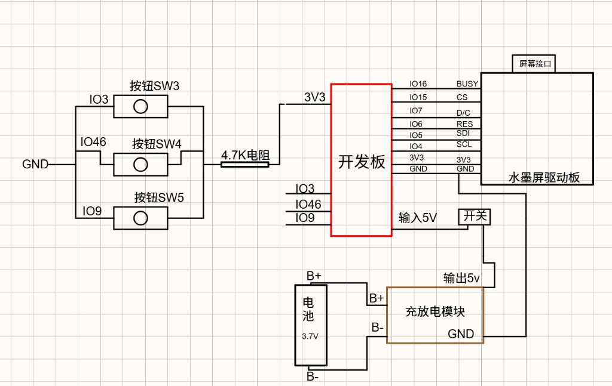

# epaper_uploader — ESP32-S3 智能墨水屏终端

[](https://docs.espressif.com/projects/esp-idf/en/v5.5.1/)
[](LICENSE)
[]()

> 一款基于 ESP32-S3 的低功耗三色墨水屏智能终端，支持图片展示、天气、时钟、日历、课程表、待办等功能，通过 Web 界面管理，开箱即用。  
> **发布版本：v2.3.0**（与根目录 `CMakeLists.txt` 中 `PROJECT_VER` 一致；烧录后请以串口 `App version` 或 `GET /version` 的 JSON 字段 `version` 为准）。文档导航见 [文档索引.md](文档索引.md)。

## 💬 交流群（QQ）

- 群号：**1102708081**（用手机 QQ 搜索群号加群，交流使用、复刻与固件问题）

## ✨ 项目亮点

- 🖼️ **三色墨水屏** — 支持黑白红三色显示，Floyd-Steinberg 抖色算法
- 📡 **WiFi 配网** — 手机热点一键配网，mDNS 局域网发现，支持 WPA2/WPA3 自适应认证
- 🌐 **Web 管理** — 响应式 UI，三套主题，手机/电脑均可操作
- 🔋 **超低功耗** — 闲置可进深度睡眠（μA 级），定时器/按键唤醒；双启动路径（完整服务 ↔ 快速刷屏），支持跨深睡的显示模式一致性记忆
- 🔄 **OTA 升级** — 双分区设计，Web 端一键升级固件
- 🔒 **安全与稳定** — 在网页中配置 Basic Auth 后，敏感 POST / 推屏类接口需鉴权；未配置时开放以便首次配网（详见 `ENGINEERING_DOCS.md` §4.5）；多核并发锁与防数据撕裂
- 🎓 **课程表** — 学期周次管理，自动高亮当前课程
- 🌤️ **天气日历** — 和风天气 API + 农历 + 节气 + 节日
- 📋 **待办/倒计时** — 优先级管理 + 进度条 + 目标日期倒数
- 🎨 **画布留言板** — WYSIWYG Web 可视化编辑器，支持文本、形状、图标混合排版

## 📷 功能展示

| 功能 | 说明 |
|------|------|
| 图片展示 | JPEG / PNG / BMP 上传，Floyd-Steinberg 抖色，拉伸全屏显示 |
| 画廊轮播 | 自动顺序 / 随机轮播，间隔可配置 |
| 时钟表盘 | 自动刷新，数字时钟样式，可叠加天气摘要 |
| 万年历 | 月视图 + 农历 + 节气 + 节日 + 今日红圈 |
| 天气 | 和风天气 API，实时 + 3 天预报 |
| 课程表 | 学期周次 + 7×12 网格 + 当前/下节课高亮 |
| 待办事项 | 优先级(普通/重要/紧急) + 完成状态 + 进度条 |
| 倒计时 | 最多 3 个目标日期倒数 |
| 留言板 | 自定义文字 / 字号 / 对齐 / 颜色 |
| 画布留言板 | 可视化 Web 编辑器，支持任意拖拽排版文本、直线、矩形、椭圆与内置/自定义图标 |
| 物理按键 | 3 键切换**上述 7 种**轮显模式（上一个 / 刷新 / 下一个）；留言板与画布**仅通过网页**编辑推屏，不参与按键循环 |
| 深度睡眠 | 闲置自动入睡 + 定时器/按键唤醒 |

下图与仓库目录中**文件名一一对应**（`网页效果展示图片/`、`水墨屏实物展示/`、`水墨屏内部图/`、`复刻所需物料图/`）。

### Web 界面截图

| `上传面板.png` | `设备配置.png` |
| :---: | :---: |
|  |  |

| `课程表管理.png` | `待办事项.png` |
| :---: | :---: |
|  |  |

### 墨水屏实物

| `双屏-时钟与立绘.jpg` | 实物展示 |
| :---: | :---: |
|  |  |

| 实物展示 | 实物展示 |
| :---: | :---: |
|  |  |

| 实物展示 | 实物展示 |
| :---: | :---: |
|  |  |

## 🔧 硬件要求

主控为 **ESP32-S3**（建议 **16MB Flash**，常见 **N16** 无 PSRAM 或 **N16R8**）；墨水屏可选 **4.2" SSD1619（400×300 BWR）** 或 **5.83" UC8179（648×480 BWR）**；电源使用低静态电流 **HE9073A** 及锂电池充放电 IC、烧录可用 **CH340** 或开发板自带 **USB** 等。两种屏幕二选一，软件支持运行时切换。

以下为复刻时常用器件的**示意配图**（文件名与下图一致）；**采购级 BOM 提要**见 [hardware/BOM.md](hardware/BOM.md)、[hardware/BOM_ACTUAL.md](hardware/BOM_ACTUAL.md)，整机原理与排障见 [ENGINEERING_DOCS.md](ENGINEERING_DOCS.md) 第三章。

### 模组（乐鑫原装）

适用于贴片/SMT 或自制载板：**ESP32-S3-WROOM-1U-N16R8**（**1U** = IPEX 外接天线；**N16R8** = 16MB Flash + 8MB PSRAM）。固件**不依赖 PSRAM**，同系列 **N16**（无 R8）亦可，但须满足默认分区对 **16MB Flash** 的要求。

| `模组-ESP32-S3-WROOM-1U-N16R8.png` |
| :---: |
|  |

### 开发板（核心板）

飞线原型、对照 GPIO 丝印时，可使用市售 **ESP32-S3-N16R8 核心板**（示意图见下；具体品牌以实物为准，**请对照本页引脚表**接线）。

| `开发板-ESP32-S3-N16R8核心板.png` |
| :---: |
|  |

### 内部构造（整机 / 自定义 PCB）

磁吸一体板与 DevKit 飞线等**整机内部布置**（照片见 `水墨屏内部图/`）：

| 内部结构 | 内部结构 |
| :---: | :---: |
|  |  |

> **5.83&quot; 面板**若使用另一组 GPIO，请以 `main/epd_stub.c` 中当前面板配置为准；下表为 **4.2&quot; 默认**。

### 硬件架构与自定义 PCB

本项目已包含完整的自制 PCB 原理图（参考 `水墨屏原理图/SCH_Schematic2_2026-04-20.pdf`）。**自定义 PCB** 采用针对 Deep Sleep 优化的电源路径：
1. **锂电池直驱**：使用 **TP4054** 线性充电 IC 进行锂电池充放电管理。
2. **极低待机能耗**：摒弃传统开发板常见的高静态电流稳压器（如 AMS1117），改用 **HE9073A33M5R** 微安级 LDO 提供 3.3V 系统电源，整机深睡电流可低至 15μA。
3. **电量监控**：硬件带有 1:2 分压电阻网络，通过 ADC 接口（BAT_DET）采样电池电量。

如果你没有打样 PCB，也可以使用普通的 ESP32-S3 开发板进行面包板跳线测试。

#### 开发板基础接线图 (面包板测试用)

基础整机示意：**3.7V 电池 → 充放电模块 → 开关 → 开发板 5V 输入**；**水墨屏驱动板**经 SCL/SDI/RES、D/C、CS、BUSY 与 **3V3/GND** 接至开发板对应 IO；**SW3/SW4/SW5** 分别接 **IO9 / IO46 / IO3**，及 **GND** 与下图一致（与下表核对）。



### 引脚连接

| 功能 | GPIO | 连接到 |
|------|------|--------|
| EPD SCK | **4** | 墨水屏 SCL |
| EPD MOSI | **5** | 墨水屏 SDI |
| EPD DC | **7** | 墨水屏 D/C |
| EPD CS | **15** | 墨水屏 CS |
| EPD RST | **6** | 墨水屏 RES |
| EPD BUSY | **16** | 墨水屏 BUSY |
| 按键 SW3 | **9** | 上一个模式 |
| 按键 SW4 | **46** | 刷新当前 |
| 按键 SW5 | **3** | 下一个模式 |

> ⚠️ BUSY 引脚需上拉，不同屏幕 BUSY 极性可能不同，固件支持 NVS 配置。

## 🚀 快速开始

### 1. 环境准备

安装 [ESP-IDF v5.5.1](https://docs.espressif.com/projects/esp-idf/en/v5.5.1/esp32s3/get-started/)：

```powershell
# Windows: 下载 ESP-IDF Tools Installer
# https://dl.espressif.com/dl/esp-idf/?id=Windows
```

### 2. 克隆项目

```bash
git clone https://gitee.com/gxp666111/miaomiao.git
cd miaomiao   # 或你本地的 msp 目录名
```

### 3. 编译固件

```powershell
# 设置目标芯片
idf.py set-target esp32s3

# 编译（首次编译约 3-5 分钟）
idf.py build
```

### 4. 烧录固件

```powershell
# 首次烧录需先擦除 Flash
idf.py -p COM3 erase-flash

# 烧录固件
idf.py -p COM3 flash

# 查看串口日志
idf.py -p COM3 monitor
```

> 💡 将 `COM3` 替换为你电脑上的实际串口号。

### 5. 首次使用

1. 设备上电后自动创建 WiFi 热点 `ESP32_EPD_xxxx`（密码 `12345678`）
2. 手机连接该热点，浏览器打开 `http://192.168.4.1/`
3. 进入「设备配置」→ 连接家庭 WiFi
4. 连接后通过 `http://epdxxxx.local/` 或 STA IP 访问

## 📁 项目结构

```
msp/
├── main/                        # 固件源码（C 模块，含 HTTP / EPD / 业务）
│   ├── app_main.c               # 启动流程（双启动路径：正常/深睡快速刷新）
│   ├── epd_stub.c / epd.h       # EPD 驱动（SSD1619 / UC8179，SPI DMA）
│   ├── image_convert.c/h        # 图片解码 + Floyd-Steinberg 抖色
│   ├── http_app.c/h             # HTTP 服务（约 57 条 URI + Basic Auth + OTA）
│   ├── http_gallery.c           # 画廊相关路由
│   ├── http_features.c          # 功能模块路由
│   ├── wifi_manager.c/h         # WiFi AP/STA + 配网 + 自动重连
│   ├── scheduler.c/h            # 画廊轮播调度
│   ├── weather.c/h              # 和风天气 HTTPS
│   ├── clock_display.c/h        # 时钟表盘
│   ├── calendar_display.c/h     # 万年历 + 农历
│   ├── lunar.c/h                # 农历算法（1900-2100）
│   ├── timetable.c/h            # 课程表（7×12 网格 + 学期周次）
│   ├── todo.c/h                 # 待办事项（优先级 + 进度条）
│   ├── countdown.c/h            # 倒计时
│   ├── message_board.c/h        # 留言板
│   ├── canvas_board.c/h         # WYSIWYG 画布留言板
│   ├── http_canvas.c            # 画布 Web 编辑器路由与图标管理
│   ├── canvas_icons.h           # 内置 1-bit 画布图标库
│   ├── button.c/h               # 三键驱动（轮询 + 去抖）
│   ├── fb_render.c/h            # 帧缓冲渲染引擎
│   ├── font_data.h              # 点阵字库（ASCII + 中文）
│   ├── display_policy.c/h       # 显示策略协调
│   ├── display_mode.c/h         # 显示模式注册与切换
│   ├── power_mgr.c/h            # 深度睡眠与电源管理
│   ├── time_sync.c/h            # SNTP 时间同步
│   ├── device_identity.c/h      # 设备标识（MAC → AP SSID / mDNS）
│   ├── nvs_utils.c/h            # NVS 工具函数
│   ├── spiffs_mount.c/h         # SPIFFS 挂载 + 自动修复
│   └── lodepng.c/h              # LodePNG 第三方 PNG 解码库
├── web/                         # Web UI（构建时嵌入固件）
│   ├── index.html               # 主页：上传 / 画廊 / 状态
│   ├── config.html              # 配置：WiFi / 轮播 / 天气 / OTA / 低功耗
│   ├── timetable.html           # 课程表编辑
│   ├── todo.html                # 待办事项管理
│   ├── countdown.html           # 倒计时配置
│   └── board.html               # 画布留言板可视化编辑器
├── tools/                       # 辅助脚本
│   ├── gen_font.py              # 点阵字库生成工具
│   └── gen_city_excel.py        # 和风天气城市码导出
├── hardware/                    # 硬件提要（采购清单暂不公开）
│   ├── 开发板接线图.png           # 开发板 / 屏 / 按键 / 电源接线示意
│   ├── BOM_ACTUAL.md            # 与固件兼容性提要
│   └── BOM.md                   # 与固件兼容性提要
├── 水墨屏原理图/                  # 自制 PCB 原理图
│   └── SCH_Schematic2_*.pdf     # 包含完整充放电与低功耗 LDO 设计
├── 水墨屏实物展示/                # 整机实物与双屏效果照片
├── 水墨屏内部图/                  # 整机内部结构照片
├── partitions.csv               # 分区表（factory + 双 OTA + ~10MB SPIFFS）
├── sdkconfig.defaults           # 项目默认配置
└── CMakeLists.txt               # 顶层构建脚本
```

## 🔌 分区表

| 分区 | 类型 | 大小 | 说明 |
|------|------|------|------|
| nvs | data | 24 KB | 非易失性配置存储 |
| otadata | data | 8 KB | OTA 状态 |
| factory | app | 2 MB | 出厂固件（回滚保护） |
| ota_0 / ota_1 | app | 各 2 MB | OTA 双分区 |
| spiffs | data | ~10 MB | 图片/文件存储 |

## 🌐 Web API 概览

设备提供 **约 57 条 HTTP 路由**（方法+路径组合，以 `http_app.c` 注册表为准），主要分类：

| 分类 | 路径 | 说明 |
|------|------|------|
| 页面 | `/`, `/config`, `/timetable`, `/todo`, `/countdown` | Web UI 页面 |
| 图片 | `/upload`, `/images`, `/image`, `/show`, `/delete` | 画廊管理 |
| WiFi | `/wifi_status`, `/scan`, `/wifi_connect`, `/wifi_forget` | 网络配置 |
| 屏幕 | `/panel_config` | 屏幕型号切换 |
| 天气 | `/weather_config`, `/weather_show` | 天气配置与显示 |
| 课程表 | `/timetable.json`, `/timetable`, `/timetable_show` | 课程表管理 |
| 待办 | `/todo.json`, `/todo`, `/todo_show` | 待办事项管理 |
| 倒计时 | `/countdown_config`, `/countdown_show` | 倒计时管理 |
| 画布留言板 | `/board`, `/canvas_layout`, `/canvas_show`, `/canvas_icon_upload` | WYSIWYG 画板与素材管理 |
| 系统 | `/status`, `/version`, `/ota`, `/auth_config`, `/power_config` | 系统管理 |

> 📖 完整 API 文档见 [ENGINEERING_DOCS.md](ENGINEERING_DOCS.md#六-api-接口文档)

## ⚡ 低功耗模式

| 模式 | 电流 | 唤醒源 | 说明 |
|------|------|--------|------|
| 活跃 | 150-300mA | 按键/HTTP | 正常工作 |
| 深度睡眠 | <10μA | RTC 定时器 / GPIO | 电池续航 80+ 天 |

**双启动路径设计**（深度睡眠开启且本次为 **RTC 定时器** 唤醒时）：
- **完整启动**（上电 / 复位 / **按键 GPIO3·9 唤醒** 等）：AP+STA、mDNS、`http_app`、按键任务、欢迎屏流程；**可通过网页访问**。
- **定时器唤醒**：仅 STA、刷新 `NVS` 中记忆的模式画面后回睡；**不启动 HTTP / 不配 SoftAP**，无法在此阶段打开网页。

**HTTP Basic Auth**：可在配置页启用。启用后敏感操作需带 `Authorization`；各 `web/*.html` 在配置页保存认证后使用 `localStorage`（`epd_auth_u` / `epd_auth_p`）自动附带请求头。详见 [ENGINEERING_DOCS.md](ENGINEERING_DOCS.md) 第七章。

## 📚 文档导航

| 文档 | 说明 | 适用人群 |
|------|------|---------|
| [文档索引.md](文档索引.md) | 全部文档导航与按角色检索 | 所有人 |
| [ENGINEERING_DOCS.md](ENGINEERING_DOCS.md) | 工程技术文档（架构/API/模块）⭐ | 开发者 |
| [IMPLEMENTATION.md](IMPLEMENTATION.md) | 技术实现详解（算法/驱动） | 核心开发者 |
| [ROADMAP.md](ROADMAP.md) | 开发规划与进度 | 贡献者 |
| [hardware/BOM.md](hardware/BOM.md) | 硬件与固件对齐提要（无采购表） | 复刻者 |
| [COURSE_TABLE_README.md](COURSE_TABLE_README.md) | 课程表功能说明 | 课程表用户 |

> **说明**：双屏切换、排障步骤等见 [ENGINEERING_DOCS.md](ENGINEERING_DOCS.md)；若你本地另有 `docs/` 子目录教辅材料，以实际仓库文件为准。

## 🤝 参与贡献

1. Fork 本仓库
2. 创建功能分支 (`git checkout -b feature/xxx`)
3. 提交更改 (`git commit -m 'Add xxx'`)
4. 推送到分支 (`git push origin feature/xxx`)
5. 提交 Pull Request

## 📄 许可证

本仓库采用 **[PolyForm Noncommercial License 1.0.0](https://polyformproject.org/licenses/noncommercial/1.0.0/)**（全文见根目录 [`LICENSE`](LICENSE)）。

- **允许**：个人学习、研究、修改与非商业性使用、分发（须附带许可证全文）。
- **商业使用**：默认**不在** PolyForm 非商业许可范围内；若你希望将本项目用于营利（如量产销售、商用 SaaS 等），须事先联系著作权人并取得**书面同意**，双方可另签商业许可协议。**经作者同意后**方可商用。
- PolyForm 对「非营利机构、学校、部分公共机构」等有单独说明，请以英文正文为准。**商用 / 授权洽谈**：`430601574@qq.com`，微信 `GXPmiaomiao`，或 Gitee 仓库 Issue / 私信（详见 [`LICENSE`](LICENSE) 文末）。

**非法律建议**：若涉及商用或纠纷，请咨询律师；你可把 `LICENSE` 顶部的 `Required Notice` 改为真实姓名或法人名称。

---

> 💡 **复刻提示**：PCB 和外壳文件将在后续单独发布，请关注仓库更新。
